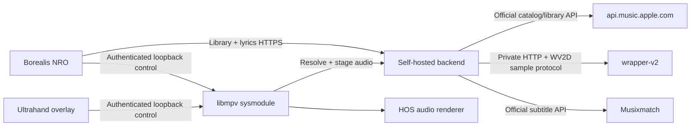

# Architecture

## Process ownership

The NRO owns browsing and lyric rendering. Its network worker performs blocking I/O away from the render thread. UI actions that replace lists are applied after the input dispatch returns; focus moves to a persistent navigation control before old rows are freed. Generation numbers discard outdated page results. Lyrics are also checked against the current song ID.

The overlay opens a short loopback connection for commands and polls state every 750 ms. Connections time out after 300 ms, so an unavailable sysmodule cannot block it indefinitely. It does not contact Apple or the backend.

The sysmodule binds **127.0.0.1:17837**, not the LAN interface. The listener validates and queues commands. One player worker owns mpv and the playback queue, performs backend resolution/downloads, advances on EOF, and publishes state behind a mutex. EOF events are matched to mpv playlist entry IDs, so an old track ending during preparation cannot skip the newly selected track. The listener continues serving state while the worker prepares a track. Up to eight pending commands are accepted; stop/skip requests wait behind an in-progress download (240-second client limit). There is no instant download cancellation in this version.

An initial queue contains at most 128 items. The NRO sends the visible library page and a continuation path. At the end of that page the sysmodule requests the next page from the backend and retains up to 28 previous items before appending it. Previous therefore has bounded history. A queue starts at the chosen page/track, rather than fetching every preceding page.

Playback uses AAC from wrapper HLS. The pinned Gamdl native extension handles fMP4 sample extraction, wrapper-v2 batch decryption, and decrypted MP4 signaling. Unhandled encryption fails instead of being served as audio. The backend pins files while responses are in flight so eviction cannot remove an active response. It serializes cache preparation, caps a track at 64 MiB and the cache at 512 MiB, expires files after 1800 seconds, and returns a range-capable `FileResponse`. The sysmodule downloads to one of two rotating local files and opens it with mpv. This design prioritizes a simple seekable input over immediate playback; preparation is not gapless and there is no prefetch, offline library or lossless/Atmos mode.

## Local control wire format

Every connection carries one request and one response. Each frame is a **4-byte big-endian unsigned JSON byte length**, followed by UTF-8 JSON. Maximum payload: 65536 bytes. Malformed/oversized frames are rejected. Requests must include `version: 1` and `token`, matching the backend device token in the shared SD configuration.

| `op` | Additional request fields | Response |
| --- | --- | --- |
| `state` | none | Current state |
| `play` | `queue: [{id,type},…]`, zero-based `index`, optional `next_path` | `{accepted:true}` |
| `toggle` | none | accepted |
| `next`, `previous`, `stop` | none | accepted |
| `seek` | `seconds` (absolute, clamped to at least zero) | accepted |
| `volume` | `value` (clamped 0–100) | accepted |

An accepted response means **queued**, not that playback succeeded. Errors are `{error:"…"}`. State contains `status`, `paused`, `position` and `duration` in seconds, `volume`, and the resolved `track`. Queue position/size refer to the retained queue window. Track preparation or mpv errors appear in state. Poll to observe completion.

This is a local socket protocol, not a registered Horizon CMIF service. Loopback sockets let both independently built UI libraries share the same bounded framing code.

## Backend API

All `/v1/` routes require `Authorization: Bearer <DEVICE_TOKEN>`. `/health` is a public liveness probe. There is deliberately no generic Apple/wrapper proxy or account-login route.

| Route | Result |
| --- | --- |
| `GET /health` | Liveness/version only; does not prove account readiness |
| `GET /v1/library/{songs,albums,playlists}?offset=0` | `{items,next_offset}`; 100 resources per page |
| `GET /v1/library/{albums,playlists}/{id}/tracks?offset=0` | Track page |
| `GET /v1/resolve/{songs,library-songs}/{id}` | Normalized catalog song and backend-relative `stream_path` |
| `GET /v1/stream/{numeric_catalog_id}` | Decrypted fMP4; supports HTTP Range |
| `GET /v1/lyrics/{catalog_id}` | `{provider,copyright,tracking_url,lines:[{time_ms,text}]}` |

Resources are normalized to IDs, resource type, title, artist, album, duration, catalog ID and ISRC. Raw wrapper snapshots and Apple responses are never forwarded. Library uploads without catalog counterparts are reported as unavailable. Synchronized lyric access depends on the Musixmatch key's plan and track availability. Provider copyright is displayed. Review your provider agreement's attribution, reporting and tracking requirements before distribution; the generic client does not implement provider-specific analytics pixels or territory policy enforcement.

## Secrets and hosting

The server stores the Media Services private key, creates one-hour developer tokens, and reads the operator's MusicKit-authorized Music User Token from a mounted secret. `scripts/authorize-musickit.py` serves a localhost-only browser authorization page using official MusicKit JS. It creates a 15-minute developer JWT for that browser and writes the resulting user token to a mode-0600 host file after a CSRF-protected callback. The server exits after authorization; rerun it when Apple revokes/expires the user token. Catalog/library calls use Apple's documented bearer and Music-User-Token headers. Wrapper authentication is administered directly on the host; the Switch never collects Apple passwords or 2FA codes. The MusicKit browser account and wrapper playback account must be the same subscriber. Automatic token renewal, device pairing and multiple account sessions are outside this version.

The Switch holds only your self-issued backend device token. Anyone with that token can access this deployment's library, audio, and lyrics, so use HTTPS outside a trusted private LAN and rotate it in both configurations if needed. No logs intentionally include authentication values. Uvicorn access logs are disabled in Docker. The Docker image defaults to UID 10001; Compose runs as the configured host UID/GID to read mode-0600 secret files. Both use a read-only root and a bounded tmpfs audio cache. Bring your own HTTPS reverse proxy. Do not expose wrapper's unauthenticated control/decrypt endpoints through that proxy.

The sysmodule NPDM currently uses development-template filesystem/service permissions and broad syscall capabilities. It should be narrowed after hardware service tracing; it is not a minimal-permission production manifest.

## Upstream references

- [Apple Music API](https://developer.apple.com/documentation/applemusicapi) and [user authentication](https://developer.apple.com/documentation/applemusicapi/user-authentication-for-musickit).
- [Media Services keys](https://developer.apple.com/help/account/capabilities/create-a-media-identifier-and-private-key/).
- [wrapper-v2 HTTP and WV2D protocols](https://github.com/glomatico/wrapper-v2).
- [Gamdl streaming implementation](https://github.com/glomatico/gamdl).
- [Musixmatch developer portal](https://developer.musixmatch.com/).
- [libultrahand](https://github.com/ppkantorski/libultrahand) and [Borealis](https://github.com/dragonflylee/borealis).
