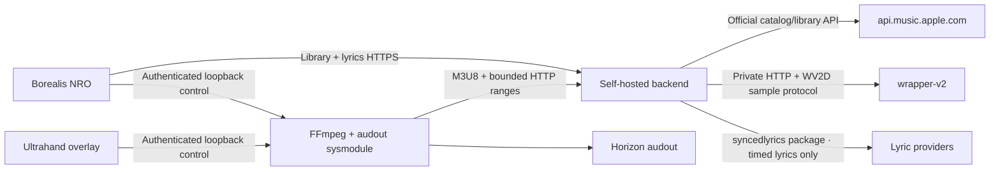

# Architecture

## Process ownership

The NRO owns browsing and lyric rendering. Its network worker performs blocking I/O away from the render thread. UI actions that replace lists are applied after the input dispatch returns; focus moves to a persistent navigation control before old rows are freed. Generation numbers discard outdated page results. Lyrics are also checked against the current song ID.

The overlay opens a short loopback connection for commands and polls state every 750 ms. Connections time out after 300 ms, so an unavailable sysmodule cannot block it indefinitely. It does not contact Apple or the backend.

The sysmodule binds **127.0.0.1:17837**, not the LAN interface. The listener validates and queues up to eight commands while a single worker owns decoding, PCM buffers and the playback queue. Direct FFmpeg uses the isolated AAC/ALAC build; four page-aligned 16 KiB buffers feed Horizon `audout`, following the reusable-buffer approach in sys-tune. EOF advances only after the current decoder has drained its resampler and every queued PCM buffer has finished, avoiding an old-track EOF racing a new selection.

Play/stop/skip/seek/pause increment an operation revision. Curl progress and FFmpeg interrupt callbacks cancel superseded operations; credentials are also checked during active transfers. A cancelled partial MP4 read is reopened and sought from the played position before resuming, rather than reusing a partially consumed demuxer packet. DNS/connect cancellation remains subject to platform resolver behavior; connects are capped at five seconds, byte-range requests at twenty seconds, and initial backend preparation at 190 seconds. Volume commands do not discard decode state.

An initial queue contains at most 128 items. The NRO sends the visible library page and a continuation path. At the end of that page the sysmodule requests the next page from the backend and retains up to 28 previous items before appending it. Previous therefore has bounded history. A queue starts at the chosen page/track, rather than fetching every preceding page.

Playback selection prefers ALAC, AAC, then AAC-web; Atmos/AC-3 are excluded. Decryption uses wrapper-v2 only. The backend serializes preparation, then invokes host FFmpeg with `-c:a copy` to create indexed fragmented MP4. The default track cap is 256 MiB and total cache cap is 512 MiB. Remuxing reserves space for both source and output; temporary files and child processes are cleaned on failure/cancellation. No audio re-encoding is performed. In-flight responses pin files, and access timestamps are tracked separately so cache eviction does not change media ETags.

`GET /v1/playback/{id}.m3u8` returns a VOD playlist with an initialization byte range and one media byte range over `/v1/stream/{id}`. It contains no credentials or wrapper URLs. The production player supports this controlled single-file backend layout. It reconstructs a seekable virtual MP4 through custom FFmpeg AVIO, using 32 KiB AVIO buffering and one 256 KiB curl range cache. It rejects external media URLs, encryption tags, mismatched ranges, oversized bodies, and changed ETags. FFmpeg networking is disabled; HTTP/TLS belongs to curl, using the saved backend session and bundled CA store. Track data is never written to SD.

One codec thread decodes native AAC/ALAC, converting bounded chunks to 48-kHz signed-16 stereo with libswresample. Input is limited to 192 kHz/eight channels, packets to 1 MiB, probes to 256 KiB, indexes to 128 KiB, and individual FFmpeg allocations to 2 MiB. Seeking recreates codec/resampler state, decodes preceding history for AAC/SRC preroll, then discards PCM up to the requested output sample. There is no gapless playback or prefetch; host decryption/remux preparation is still necessary before initial streaming.

## Hekate Toolbox lifecycle

The SD package includes `atmosphere/contents/420000000000534D/toolbox.json` with the same program ID as the NPDM and `requires_reboot: false`. [Hekate Toolbox's sysmodule manager](https://github.com/WerWolv/Hekate-Toolbox/blob/master/source/gui/gui_sysmodule.cpp) uses this to expose live process launch/termination rather than requiring a reboot. Its toggle also creates/removes `flags/boot2.flag`, controlling automatic startup on subsequent boots. The package leaves that flag absent by default.

Disabling is process termination, not an in-player pause or a graceful queue drain: audio and in-flight operations stop, and re-enabling starts with an empty queue. Configuration stays on SD. The control server already uses `SO_REUSEADDR`, and clients use fresh short-lived connections for every request, so they do not retain a session to the old process. The NRO/overlay show the unavailable state while stopped and retry state polling automatically. A start still requires valid configuration and sufficient system memory; metadata cannot make an oversized process fit the system pool.

Packaging validates the Toolbox display name, exact title ID and live-toggle flag, and hashes `toolbox.json` in the archive manifest. Live toggling, renderer cleanup and immediate relaunch remain hardware acceptance checks.

## Local control wire format

Every connection carries one request and one response. Each frame is a **4-byte big-endian unsigned JSON byte length**, followed by UTF-8 JSON. Maximum payload: 65536 bytes. Malformed/oversized frames are rejected. Requests must include `version: 2` and `session`, matching the saved backend session in the shared SD configuration. The listener accepts only loopback connections.

| `op` | Additional request fields | Response |
| --- | --- | --- |
| `state` | none | Current state |
| `play` | `queue: [{id,type},…]`, zero-based `index`, optional `next_path` | `{accepted:true}` |
| `toggle` | none | accepted |
| `next`, `previous`, `stop` | none | accepted |
| `seek` | `seconds` (absolute, clamped to at least zero) | accepted |
| `volume` | `value` (clamped 0–100) | accepted |

An accepted response means **queued**, not that playback succeeded. Errors are `{error:"…"}`. State contains `status`, `paused`, `position` and `duration` in seconds, `volume`, and the resolved `track`. Queue position/size refer to the retained queue window. Track preparation, transport or decoder errors appear in state. Poll to observe completion.

This is a local socket protocol, not a registered Horizon CMIF service. Loopback sockets let both independently built UI libraries share the same bounded framing code.

## Backend API

All `/v1/` routes require an active backend account: a signed-in session cookie for native clients and browsers (HTTP Basic remains available for external API scripts). The login shell, static assets and `/health` are public. Browser sessions expire after 12 hours and use HttpOnly, SameSite=Strict cookies (Secure by default). Cookie-authenticated mutations require a session CSRF token; supplied Origins must match `PUBLIC_URL`. There is no generic Apple/wrapper proxy or public registration.

| Route | Result |
| --- | --- |
| `POST /auth/login`, `GET /auth/me`, `POST /auth/logout` | Browser sign-in, user/CSRF state and sign-out |
| `POST /auth/password` | Change own password and revoke sessions |
| `POST /auth/apple/qr/{start,details,status,cancel}` | Session-bound Apple library QR linking; all require authentication and CSRF |
| `POST /auth/apple/start`, `POST /auth/apple/callback`, `DELETE /auth/apple` | Session-bound MusicKit linking and unlinking |
| `GET/POST /admin/accounts`, `PATCH/DELETE /admin/accounts/{id}` | Admin-only account management |
| `DELETE /admin/accounts/{id}/apple` | Admin removes a library link |
| `GET /v1/catalog/search?term=…&offset=0` | Public catalog songs, albums and playlists |
| `GET /v1/catalog/{albums,playlists}/{id}/tracks?offset=0` | Public collection tracks |
| `GET /health` | Liveness/version only; does not prove account readiness |
| `GET /v1/library/{songs,albums,playlists}?offset=0` | `{items,next_offset}`; 100 resources per page |
| `GET /v1/library/{albums,playlists}/{id}/tracks?offset=0` | Track page |
| `GET /v1/resolve/{songs,library-songs}/{id}` | Normalized catalog song and backend-relative `stream_path` |
| `GET /v1/playback/{numeric_catalog_id}.m3u8` | Authenticated single-file VOD manifest |
| `GET /v1/stream/{numeric_catalog_id}` | Decrypted fMP4; supports HTTP Range |
| `GET /v1/lyrics/{catalog_id}` | `{provider,copyright,tracking_url,lines:[{time_ms,text}]}` |

Resources are normalized to IDs, resource type, title, artist, album, duration, catalog ID and ISRC. Raw wrapper snapshots and Apple responses are never forwarded. Library uploads without catalog counterparts are reported as unavailable. All lyric searches go through the `syncedlyrics` Python package with `synced_only=True`, matching title and artist. No Musixmatch API key is read or required. The blocking search runs outside the API event loop. LRC timestamps (including offsets and repeated timestamps) are normalized to milliseconds; metadata is ignored and plaintext is never assigned invented timing. Missing synchronized lyrics return 404, and package exceptions return a sanitized 502. The response identifies `syncedlyrics`; it does not claim an upstream provider that the package does not report. Docker sets `HOME=/tmp` so its provider cache stays on writable tmpfs.

## Secrets and hosting

The server retains the Media Services P-256 private key and signs one-hour ES256 developer JWTs. Before returning a browser-origin-bound JWT, it verifies acceptance against Apple’s protected catalog search API; server API JWTs remain separate and origin-unbound. Signing configuration errors and Apple rejection produce actionable errors before authorization starts. Each account links its own library using official MusicKit JS on the website. A ten-minute, single-use nonce binds the callback to the initiating user and browser session. The backend verifies the resulting token with Apple's `me/storefront` endpoint before storing it. Catalog requests use the developer JWT; only that user's `me/` requests receive their Music User Token. Tokens are Fernet-encrypted in SQLite using a separate mode-0600 key in `DATA_DIR`. Persist and back up both files together. Relink after Apple revokes or expires authorization.

The NRO Settings page requests an Apple Music QR code from the backend. The backend encodes its `PUBLIC_URL` plus a random 256-bit code in a URL fragment, returning a binary QR matrix with a four-module quiet zone and a display-only confirmation number. The NRO renders the matrix directly without an image decoder and polls every three seconds. This functionality runs only in the NRO; it does not add Python, QR generation, or polling to the sysmodule.

QR requests last five minutes and are bound to the initiating user and backend session. Phone users must sign into the existing website as that same backend user. MusicKit is prepared before the authorization button becomes enabled, so `authorize()` runs directly in the phone's click gesture. The existing callback accepts an optional QR binding; bound nonces cannot be submitted as ordinary web authorizations. Cancellation, replacement, unlinking, or session revocation cascades to bound nonces. The token-storage transaction checks expiry/binding again after Apple's response and atomically marks the QR complete. Only the initiating Switch session can consume the single-use completion result; it receives public library-link status, never a new backend session, Music User Token or developer JWT. Ordinary website authorization also prepares MusicKit before the click. The browser verifies the exact developer JWT configured in MusicKit and submits only a valid Music User Token returned after authorization. Existing authorized Apple sessions require a click to clear and a second click to authorize again. The QR capability is hashed in SQLite and removed from the phone's address bar before MusicKit loads. All QR API calls use POST bodies and existing session/CSRF protection.

Only the reserved admin can create, manage and delete accounts. Its password is bootstrapped from `ADMIN_PASSWORD` on the first start; later starts preserve the database password. Passwords use Argon2; random browser session tokens and linking nonces are stored as SHA-256 hashes. Failed logins are throttled. Disabled/deleted accounts and revoked sessions are rejected on subsequent requests. Password reset/change revokes browser sessions. No Apple password or 2FA code is collected. Wrapper authentication is administered separately on the host: playback uses its subscribed account, independently of each user's library token. Catalog-only backend accounts need no Apple link.

The NRO presents server URL, username and masked password inputs using the Nintendo Switch keyboard applet. It calls `/auth/login`, receives the HttpOnly session through libcurl's cookie engine, and saves only the URL, username and session to SD. Passwords, Apple tokens and developer keys are not saved there. Saved sessions are validated at launch and every 30 seconds while the NRO runs. Backend 401 responses return it to login and clear authorization; an expired Apple library link returns 409 instead, leaving the backend account signed in. Logout removes local authorization and requests server revocation with the session's CSRF token. Protect the SD session and use HTTPS. Both native and browser sessions expire after 12 hours and are revoked by password changes, account disabling or deletion. Native API calls send the session cookie; no replacement device-token scheme is introduced. No logs intentionally include authentication values. Docker disables Uvicorn access logs, runs non-root with a read-only root and bounded tmpfs audio cache, and persists accounts under `/data`. Compose uses the configured host UID/GID to read the mode-0600 Apple key and data files. Bring your own HTTPS reverse proxy, configure its public origin exactly, and keep wrapper control/decrypt ports private.

The sysmodule starts without a login and reloads saved session changes once per second and before queued commands. The listener checks the current saved session on each loopback request; the overlay reloads it on each poll. A session change stops playback and discards the previous queue; queued commands carry their originating session and cannot play under a different account. In-flight transport observes credential changes through its cancellation callback; the worker then closes the decoder and flushes PCM.

The NRO embeds `resources/certs/cacert.pem` in its RomFS. The sysmodule mounts its separately packaged certificate-only image at `atmosphere/contents/420000000000534D/romfs.bin` using libnx `romfsMountFromFsdev`; it does not depend on a homebrew NSP loader exposing RomFS. Both clients use `romfs:/certs/cacert.pem` with peer/hostname verification enabled. Packaging checks the exact certificate and MPL license bytes in both images. Updating the checked-in Mozilla/curl snapshot and rebuilding updates trust; no CA path is read from configuration.

The sysmodule NPDM currently uses development-template filesystem/service permissions and broad syscall capabilities. It should be narrowed after hardware service tracing; it is not a minimal-permission production manifest.

## Upstream references

- [Apple Music API](https://developer.apple.com/documentation/applemusicapi) and [user authentication](https://developer.apple.com/documentation/applemusicapi/user-authentication-for-musickit).
- [Media Services keys](https://developer.apple.com/help/account/capabilities/create-a-media-identifier-and-private-key/).
- [wrapper-v2 HTTP and WV2D protocols](https://github.com/glomatico/wrapper-v2).
- [Gamdl streaming implementation](https://github.com/glomatico/gamdl).
- [syncedlyrics package](https://github.com/moehmeni/syncedlyrics).
- [libultrahand](https://github.com/ppkantorski/libultrahand) and [Borealis](https://github.com/dragonflylee/borealis).

Catalog search and catalog album/playlist track lists allow anonymous GET requests using only the server developer JWT and configured storefront. They never receive a Music User Token. Explicit invalid or expired credentials still return 401; the NRO can clear them and continue as a guest. Library, account, QR linking and playback endpoints remain authenticated. Guest native configuration persists only the server URL and optional username, with an empty session; session-required sysmodule/overlay configuration validation remains strict.
